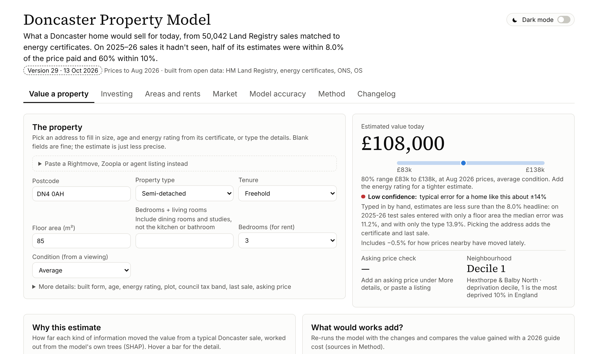
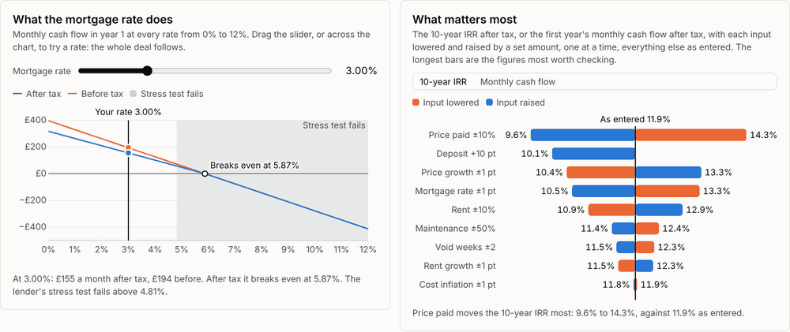

# Doncaster Property Model

[](https://github.com/oliverhutch2021/doncaster-property-model/actions/workflows/tests.yml)
[](https://oliverhutch2021.github.io/doncaster-property-model/)
[](LICENSE)

A machine-learning valuation model for homes in Doncaster, built from open data, with an interactive dashboard that
runs the model in the browser. It estimates what a home would sell for today, with an 80% price range and a confidence
level, and turns that into buy-to-let, neighbourhood-screening and buy-refurbish-sell figures.

**[Open the live dashboard](https://oliverhutch2021.github.io/doncaster-property-model/)** · [How it works (PDF)](docs/How-the-model-works.pdf) ·
[Technical notes](docs/technical-notes.md) · [Decision log](docs/DECISIONS.md)



## Results

Scored on 5,995 Doncaster sales from January 2025 to August 2026 that the model never saw. It was trained on
2015-2023 sales and tuned on 2024, so it is judged the way it would be used. Each method below only sees sales at least
two months old, as published Land Registry data would allow.

| Method | Median error | Within 10% of the price |
|---|---|---|
| **This model** (LightGBM, 62 features, local correction) | **8.1%** | **59%** |
| Hedonic regression on the same features, with a fixed effect per postcode sector | 9.8% | 51% |
| Last sale × UK House Price Index by type (how online "worth now" tools work) | 12.7% | 42% |
| Median £/m² of the 10 nearest same-type sales × floor area | 13.6% | 39% |
| Median price of same-type sales in the postcode sector | 17.5% | 31% |

- **Stable over time:** a year-by-year backtest from 2020, with the price index rebuilt as it was known at the time,
  gives 7.7% to 8.4% median error every year.
- **Honest ranges:** the 80% ranges held the sale price for 80.5% of test sales. A second model predicts each
  estimate's confidence: High-confidence estimates had a 4.9% median error, Low ones 11.3%.
- **Assessors' standard:** the IAAO ratio study gives a COD of 12.7, inside the standard of under 15.
- The last-sale and nearest-sales methods can't value every home (72% to 98% of them); the model is scored on all of
  them. The full comparison, with coverage, is in the [technical notes](docs/technical-notes.md#how-it-compares-srccompare_methodspy).

## What the dashboard does

- **Value a property:** pick an address or paste a Rightmove or Zoopla listing; get the estimate, range, confidence,
  a condition adjustment calibrated on repeat sales, an asking-price check, comparable sales and a breakdown of what
  moved the value (SHAP, computed in the browser).
- **Investing:** the home against recent sales in its neighbourhood; a rent estimate; a full buy-to-let deal analyser
  (stamp duty, Section 24, limited company, capital gains tax, lender stress test, 10-year after-tax IRR); what the
  mortgage rate does, which inputs matter most, and what the deal would have made over each past decade; a
  buy-refurbish-sell calculator.
- **Areas and rents:** Doncaster's 39 neighbourhoods on returns, growth, risk and liquidity, with a time-lapse of
  prices since 1995.
- **Market and Model accuracy:** price indices, sales volumes and court claims; every accuracy check above, live.



## Run it

```
pip install lightgbm pandas numpy           # enough for the tests and predict.py; requirements.txt has the full pipeline's
node tests/test_units.js                     # 101 checks: tax, IRR, projections, input checks, listing parser
python tests/test_build.py                   # the public page rebuilds from source byte for byte
python tests/test_privacy.py                 # no house-level address data in anything shared
python tests/test_ui.py                      # browser tests (needs: pip install playwright pandas; playwright install chromium)
python src/predict.py --postcode "DN1 2EG" --type T --area 70 --prev-price 65000 --prev-month 2016-05
python src/build_standalone.py               # rebuild the single-file dashboard
```

`pipeline.py` runs the whole build from raw data, which isn't committed (`src/fetch_data.sh` downloads it). The
[technical notes](docs/technical-notes.md) cover each step.

## How it's built

- **Data:** about 50,000 Land Registry sales since 2015 matched to energy certificates, with deprivation, plot sizes
  from title plans, street and nearest-sale prices, and each home's certificate history.
- **Model:** LightGBM (2,043 trees) on log prices deflated by a quality-adjusted Doncaster index, with a local
  correction from recent nearby errors. Every change was tested over three random seeds and kept only if it beat the
  noise between them.
- **Checked like a real valuation tool:** temporal splits only, a strict timing check of what each feature could
  have known on the sale date, train-and-serve parity tests, and a decision log of every choice ([`docs/DECISIONS.md`](docs/DECISIONS.md)).
- **In the browser:** the full model runs client-side in plain JavaScript and d3, so the dashboard is one static page
  hosted on GitHub Pages.

```
src/          pipeline scripts and predict.py        dashboard/   page source (HTML, CSS, JavaScript)
tests/        unit, browser, build and privacy tests  public/      the built single-file dashboard
model/        the trained model and its lookups       config/      every assumption, with its source
outputs/      evaluation results and dashboard data   docs/        PDF guide, technical notes, decision log
```

## Data and licences

| Source | Used for |
|---|---|
| HM Land Registry Price Paid Data, Doncaster, 1995-2026 | Sale prices, dates, type, tenure, new build, addresses, previous sales |
| Energy Performance Certificates, Doncaster, 2012-2026 (MHCLG) | Floor area, rooms, built form, age, energy score, mains gas; tenure and EPC shares by area |
| postcodes.io (ONS Postcode Directory) | Coordinates, 2021 LSOA, ward |
| English Indices of Deprivation 2025 (MHCLG) | Neighbourhood deprivation, including crime and living environment |
| ONS Price Index of Private Rents | Doncaster rents by bedrooms and type, rent growth |
| DWP Local Housing Allowance 2026-27 | Housing benefit caps, Doncaster BRMA |
| Environment Agency flood risk by postcode (NaFRA2, 2025) | Flood risk card, map, buy-to-let warning (tested in the model) |
| DfT NaPTAN | Rail stations and bus stops (tested in the model) |
| DfE Get Information about Schools, Ofsted outcomes (Mar 2026) | Nearest schools and their grades (tested in the model) |
| OpenStreetMap (Geofabrik South Yorkshire) | Supermarkets, parks, GPs, pubs and cafés, motorway junctions, main roads (tested in the model) |
| ONS LSOA 2021 boundaries and rural-urban class | Neighbourhood map (tested in the model) |
| HM Land Registry INSPIRE Index Polygons (Doncaster) | Plot size per home (in the model) |
| OS Open UPRN | Places each EPC home on its title plan (in the model) |
| VOA Council Tax stock of properties (2025) | Council tax band check; band mix tested in the model |
| OS OpenMap Local building outlines (Apr 2026) | Possible-extension prompt (tested in the model) |
| less.co.uk and planwatch.co.uk 2026 cost guides | Extension and loft conversion costs in the what-if tool |
| gov.uk / HMRC / MHCLG guidance | Stamp duty, landlord tax, EPC rules, Renters' Rights Act (each with a source link in the dashboard) |

### Licences

The MIT licence (`LICENSE`) covers the code. The data in `outputs/`, `model/` and `public/` is derived from the
sources above and keeps their licences:

- Contains HM Land Registry data © Crown copyright and database right 2026, licensed under the
  [Open Government Licence v3.0](https://www.nationalarchives.gov.uk/doc/open-government-licence/version/3/).
  Price Paid Data contains address data processed against Ordnance Survey's AddressBase Premium product, which
  incorporates Royal Mail's PAF® database; it is used here to show residential property price information.
- Energy Performance Certificate data © Crown copyright, under the Open Government Licence; the address fields are
  under Royal Mail and Ordnance Survey terms, which is why the address lookup is not shared (`tests/test_privacy.py` checks this).
- Contains public sector information licensed under the Open Government Licence v3.0 (ONS, MHCLG, DWP, DfE, DfT, VOA,
  Environment Agency).
- Contains OS data © Crown copyright and database right 2026.
- Map data © OpenStreetMap contributors, under the [Open Database Licence](https://opendatacommons.org/licenses/odbl/).
  The tables built from it, `outputs/dash2/places.csv` and the OpenStreetMap columns of `outputs/dash2/pc_extras.csv`
  (food and drink nearby, distance to a main road), are shared under the same licence.
- Comparable sales in this copy keep the street and postcode only: house numbers and names are removed
  (`src/addresses.py`), and the certificate address lookup isn't included. `tests/test_privacy.py` checks both.
- d3 is used under the ISC licence (`dashboard/vendor/LICENSE-d3.txt`, also in the public page).
- The dashboard and model are a statistical estimate, not a survey, mortgage valuation, or financial or tax advice.

Raw data is not committed. Run `src/fetch_data.sh` to download it. The EPC file needs a free GOV.UK One Login
download (see the script).

## Limitations

- Condition isn't in any open dataset, so it is a user input calibrated from repeat sales.
- Rents are Doncaster-wide averages by type, so area yields overstate returns in the cheapest areas.
- About 6% of sales have no matched EPC; they are valued without size, with a wider range.
- Not a survey, mortgage valuation or financial advice.
